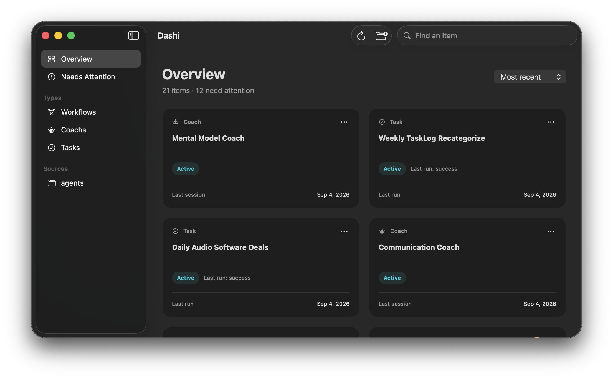

# Dashi

Your personal dashboard.

Drop a folder to see the status and latest updates across your workflows, coaches, tasks, conversations, and opportunities. Find what needs attention at a glance.

- Compact status cards with automatic refresh.
- Filter by source or type, and search by name.
- Copy prompts for coaching, running tasks, starting or resuming workflows, resuming conversations, and evaluating opportunities. Completed and abandoned workflows offer status prompts only.
- Coaches show when they last ran against their target cadence (`schedule` in the manifest): On track, Due soon, or Overdue. Sort by Due to see who is falling behind.
- Opportunities use the same compact status cards as other packages, with no overdue cadence.
- Local and read-only. No AI or account required.

Requires macOS 26.5 or later and Apple Silicon.
